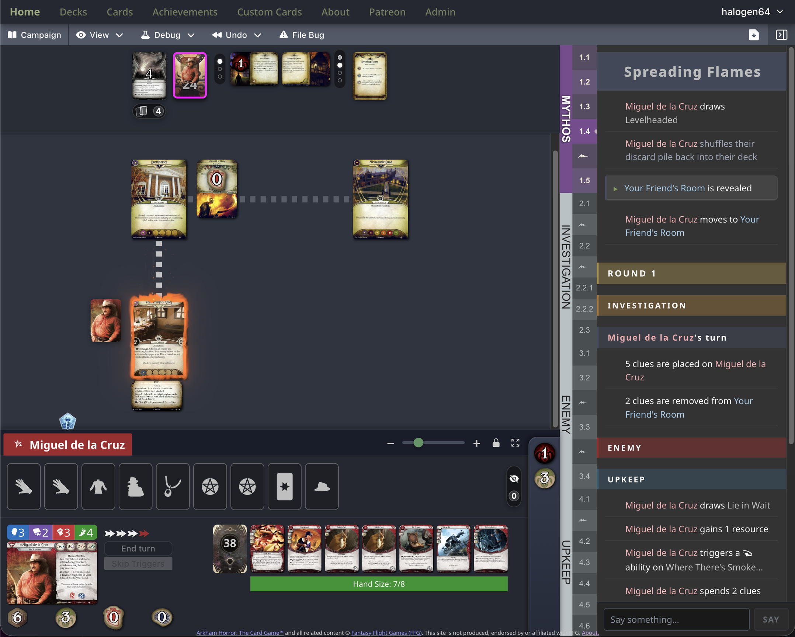

# Arkham Horror LCG



The goal of this project is to implement a web version of Arkham Horror with as
many of the rules implemented as possible.

## Features

* Multiplayer up to 4 players
* Multiplayer solitaire
* Tarot Readings
* Deck import from ArkhamDB and arkham.build

## Finished Content

### Chapter 1

All content is implemented. You can use every player card (including promos and
parallels) and play every campaign and scenario (including challenge
scenarios). The only things currently missing are some of the refractions,
designer dares, and other variants.

### Chapter 2

All content before 2027 is implemented.

* Brethren of Ash
* Children of Blood (Beta)
* Traces to Nowhere (Beta, side story)

Content marked beta will require enrollment in the beta program which is
available from the settings page. Beta content is likely to have more bugs than
usual and the expectation is that games may break in non-recoverable ways.

### Homebrew

There is fan-made content in here too: four campaigns and nine side stories
written by people in the community. Right now all Homebrew content is in
beta so you will need to enroll in the beta program before they show up.

Want to make your own? See [Writing homebrew content](./docs/homebrew.md).

## I just want to try this out on my computer

Easiest is the [prebuilt package](./docs/install/prebuilt.md): one download
with the game, the database and the web server already inside it. Nothing to
install, not even Docker.

If you would rather run it in Docker there is a one-liner for
[Linux](./docs/install/docker-linux.md), a longer path on
[Windows](./docs/install/docker-windows.md), and a
[by-hand version](./docs/install/docker-manual.md) if you want to write the
compose file yourself.

Later on, [upgrade.sh](./docs/install/updating.md) updates a Docker install or
a checkout. The prebuilt package updates itself.

## Local dev

This is the non-Docker path: the servers run on your machine, from the source
tree, with rebuilds and hot reload. The Docker instructions above are a
different thing and need none of this.

### Setup

```
./scripts/setup
```

On Windows this all happens inside WSL, which takes a few steps first — see
[Developing on Windows](./docs/windows.md).

It checks for everything the build needs, prints whatever is missing with the
command that fixes it, and installs them if you say yes. Then it installs the node
modules, creates the database, applies the migrations, and builds the backend
once.

`--check` reports and changes nothing. `--yes` skips the prompt, `--no-build`
leaves out the backend build, `--no-db` leaves the database alone, and
`--with-images` also fetches the image assets.

What it looks for, if you would rather do it yourself:

* ghcup, and GHC 9.14.1 through it. `backend/stack.yaml` sets `install-ghc:
  false`, so stack will not fetch a compiler of its own — it wants
  `ghc-9.14.1` on PATH, whatever plain `ghc` happens to be.
* Stack 3.7.1 or newer
* Node 20.19 or newer, which is vite 7's floor
* Postgres, with something answering on localhost:5432
* `libpq` and `gmp`, which `postgresql-libpq` and GHC link against

The versions are read out of `backend/stack.yaml` rather than written into the
script, so a resolver bump carries them along.

### Running the server

```
./scripts/boot
```

All three servers in one terminal: the API on :3002, the frontend on :8080, and
the third edition frontend on :8081. A status block sits at the top of the
terminal saying what each one is up to — building and which module, build
failed, hot reload — while their output scrolls past underneath. The keys stop
and start them one at a time:

| Key | |
| --- | --- |
| `a` `f` `t` | stop or start the api, the frontend, the 3ed frontend |
| `A` `F` `T` | restart it |
| `l` | cycle which server's output is shown |
| `s` | print a status block |
| `b` | open the frontend in a browser |
| `q` | quit, stopping everything |

The backend rebuilds and restarts itself as you edit, vite keeps its hot
reload, and each server's output also lands in `tmp/dev/`.

`--no-3ed` leaves the third edition frontend out and `--only api,web` picks
what to run. `DEBUG=1 ./scripts/boot` turns on the API's info logging (see
`Arkham.Debug`). `API_TARGET=api.watch.test.entr.log ./scripts/boot` runs the
test suite on every rebuild too. It always runs the frontends with an empty
`VITE_ASSET_HOST`, so images come from `frontend/public` instead of the CDN.

Either half still runs on its own, if you would rather keep two shells:

```
cd backend && make api.watch.entr
cd frontend && npm run dev
```

`api.watch.entr` rather than `api.watch` because stack's `--file-watch` stopped
seeing edits under `library/` on this tree; `backend/Makefile` has the long
version of why, and every other watch target with it.

### Database

`scripts/setup` creates `arkham-horror-backend` from `setup.sql`, then applies
everything in `migrations/deploy` that the dump does not already contain,
recording what it ran in `arkham_schema_migrations`. By hand:

```
createdb arkham-horror-backend
psql -d arkham-horror-backend -f setup.sql
./scripts/setup --no-build      # applies the migrations on top
```

`migrations/sqitch.plan` and `migrations/sqitch.conf` are still in the tree but
sqitch is not what deploys any of this — the plan is read for the order of the
files in `migrations/deploy` and nothing else.

### Images

Image assets (~2.9 GB) are **not stored in the git repository**. They are hosted
on CloudFront and the app loads them from the CDN by default — no extra setup
needed. `scripts/boot` is the exception: it runs the frontends with
`VITE_ASSET_HOST` empty, which serves them out of `frontend/public`, so fetch
them if you boot that way and want to see art.

Fetching needs the `aws` CLI and `curl`:

```
make fetch-images     # Everything (~2.9 GB)
make fetch-cards      # English card images only (~755 MB)

# Or use the script directly:
./scripts/fetch-assets.sh en        # All English/static images (~1.3 GB)
./scripts/fetch-assets.sh en+fr     # English + French (recommended for French play)
./scripts/fetch-assets.sh en+es     # English + Spanish
./scripts/fetch-assets.sh en+ita    # English + Italian
./scripts/fetch-assets.sh en+ko     # English + Korean
./scripts/fetch-assets.sh en+zh     # English + Chinese
./scripts/fetch-assets.sh fr        # French card translations only
./scripts/fetch-assets.sh cards     # English + homebrew card images only (~755 MB)
./scripts/fetch-assets.sh 3ed       # Third edition images only (~106 MB)
```

If you only have Docker (no local AWS CLI), use the Docker-based targets instead:

```
make fetch-images-docker    # Everything via Docker (~2.9 GB)
make fetch-cards-docker     # English card images only via Docker

# Or run directly with the same targets as above:
docker compose --profile fetch-images run --rm fetch-images en
docker compose --profile fetch-images run --rm fetch-images en+fr
docker compose --profile fetch-images run --rm fetch-images fr
```

Running vite yourself, without `scripts/boot`, loads images from the CDN. To
point it at local copies anyway, create `frontend/.env.development.local`:
```
VITE_ASSET_HOST=
```

To go back to the CDN, remove the file or set
`VITE_ASSET_HOST=https://assets.arkhamhorror.app`.

If you add new images, sync them to S3 and regenerate the manifest:
```
make sync-and-manifest
```

To install a git hook that warns if you forget to update the manifest:
```
make install-hooks
```

### Offline builds

The self-contained packages at the top of this file are built by
`.github/workflows/build-offline.yml`, which runs on any `v*` tag and puts the
archives on a GitHub release. Cutting one:

```
make offline-build
```

That tags HEAD as `vYYYYMMDD.N` — picking the next free `N` for today — and
pushes the tag, which is the whole trigger. Two builds run, macOS ARM64 and
Linux x86_64; the other two platforms are in the matrix but commented out.
Each job is allowed two hours, which it needs — it compiles the Haskell and
builds PostgreSQL and nginx from source on top of that.

To build one on this machine instead, which is also how you debug the pipeline:

```
cd offline
./build_all.sh                  # --skip-deps, --clean and --verbose all work
```

It downloads its own GHC, Stack and Node rather than using yours, builds
PostgreSQL 14.15 and nginx from source so nothing carries a hard-coded path,
and leaves the archive in `offline/_dist/`. The toolchains and caches land in
`offline/_deps/` and `offline/_tmp/`, all three gitignored.

The build is not allowed to leave the source tree changed: it may patch the
frontend while it runs, but it puts it back. `offline/README.md` has the rest.

### Tests

```
cd backend && make test                     # the suite once
cd backend && make test.watch.entr          # on every change
cd backend/arkham-api && stack test --fast --test-arguments '-m "CardName"'
```

```
cd frontend && npm run tc                   # typecheck
cd frontend && npm test
```

## Homebrew content

Want to build your own campaign, scenario, or custom content? See
[Writing homebrew content](./docs/homebrew.md) — a hands-on guide to adding
cards, campaigns, traits, actions, tokens, and more without touching the base
game.

## Copyright Disclaimer

The information presented in this app about [Arkham Horror: The Card Game™][arkham], both textual and graphical, is © Fantasy Flight Games 2024. This app is a fan project and is not produced, endorsed, or supported by, or affiliated with Fantasy Flight Games.

All artwork and illustrations are the intellectual property of their respective creators. All Arkham Horror: The Card Game™ images and graphics are copyrighted by Fantasy Flight Games.

[arkham]: https://www.fantasyflightgames.com/en/products/arkham-horror-the-card-game/
[wsl2]: https://learn.microsoft.com/en-us/windows/wsl/install
